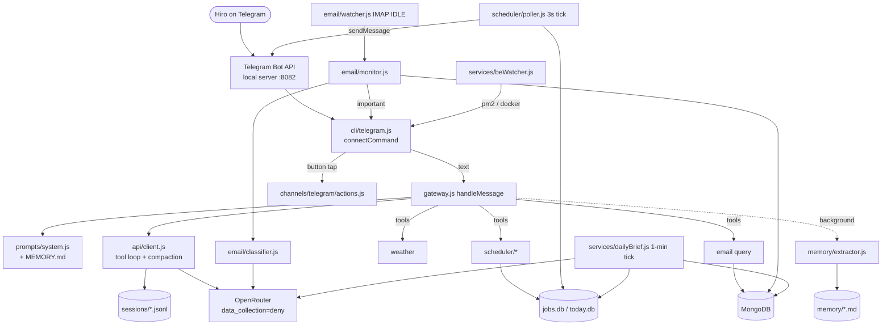

# System Overview — Ziron

> Updated: 2026-11-17. Describes the code as of this date (on top of `b203229`, plus photo input, price-sorted routing
> and the revised mail classifier prompt).
> The previous version of this file (2026-10-11) and `docs/audit/*` are historical — git history has them.

---

## 1. What it is

Ziron is a personal assistant for **Hiro** (MSc Data Science student, TU Dortmund), delivered as a
Telegram bot (`@hirojavisbot`, display name *Baymax*). One long-lived Node.js process (PM2 name `ziron`) does:

| Feature | Summary |
|---|---|
| **Chat agent** | Telegram messages → LLM (OpenRouter) with tools: reminders, weather, email search |
| **Photos** | Photos / image files (and albums) are sent to the chat model (vision); only the current turn carries image data |
| **Reminders** | One-shot, interval and recurring reminders with inline buttons (Done / Snooze) |
| **University mail** | IMAP IDLE push on the TU Dortmund inbox → LLM classification → instant Telegram alert for important mail, with "show full mail" and "remind me before the deadline" buttons |
| **Daily brief** | 07:00 brief for today, 21:00 brief for tomorrow: study / work / admin items from mail + scheduler |
| **Memory** | Short, rewritten lists of durable facts about Hiro, injected into every prompt |
| **History compaction** | Old chat turns are summarized once history exceeds ~8k tokens |
| **Service watcher** | Alerts when PM2 processes / Docker containers change state |
| **Voice channel** | HTTP + TTS dashboard — **disabled** (`voice.enabled: false`) until it is fixed |

---

## 2. Tech stack

| Layer | Technology |
|---|---|
| Runtime | Node.js ≥ 20, ESM |
| Telegram | grammY, optionally via a local Bot API server (`telegram.apiRoot`) |
| LLM | OpenRouter (OpenAI-compatible HTTP); default model `deepseek/deepseek-v4.1-flash-1017` |
| Scheduler DB | better-sqlite3: `~/.ziron/scheduler/jobs.db` + `today.db` |
| Mail + snapshots DB | MongoDB via Mongoose (`database.mongoUri`) |
| Email | imapflow (IMAP + IDLE) + mailparser |
| Weather | Google Geocoding + Open-Meteo |
| Process manager | PM2 |
| Tests | `npm test` — `node:test`, `test/*.test.mjs` (time, scheduler, mail/brief); see §11 |

---

## 3. Architecture



All outbound messages go through one `sendMessage(chatId, text, opts)` wrapper in `cli/telegram.js`:
it forces the destination to `telegram.chatId`, defaults to `parse_mode: 'Markdown'`, and **re-sends as
plain text** if Telegram rejects the Markdown ("can't parse entities"), so nothing is lost.

---

## 4. Directory map (what to open for what)

| Path | Responsibility |
|---|---|
| `ziron.mjs`, `src/cli/telegram.js` | Entry point; wires bot, scheduler, email monitor, daily brief, BE watcher, voice; Telegram command handlers |
| `src/gateway.js` | Chat turn: system prompt, tools, `onToolCall` dispatcher, OpenRouter adapter, email polling loop |
| `src/api/client.js` | `ZironClient.run` (tool-calling loop, max 10 rounds) + `compactIfNeeded` |
| `src/storage/history.js` | JSONL session store; `buildApiMessages` (starts at the latest summary boundary) |
| `src/memory/extractor.js` | Memory extraction (cursor-based) and rewriting of `~/.ziron/memory/*.md` |
| `src/prompts/system.js` | System prompt (scheduler rules, button format, environment block) |
| `src/tools/scheduler.js` | Tool schemas + pure time calculators (`calculateTime`, `calculateTimeRange`, …) |
| `src/scheduler/db.js` | SQLite schema, migrations, all job queries (`claimJob`, `getPendingJobsByRefId`, …) |
| `src/scheduler/sync.js` | Daily master → today materialization; `occurrenceOn` / `occurrencesForDate` (DST shift with date carry), `shouldRunToday` |
| `src/scheduler/poller.js` | 3 s tick: fires due jobs (claim-before-send) |
| `src/channels/telegram/actions.js` | Inline button handlers: `done`, `snooze`, `mail`, `mremind`, legacy `delete` |
| `src/channels/telegram/client.js` | grammY bot, commands, menu registration, 60 s request timeout |
| `src/channels/telegram/media.js` | Photo input: size pick (≤ 1600 px), download (local Bot API → absolute path, else HTTP), album grouping (1.5 s) |
| `src/tools/providers/email/watcher.js` | IMAP IDLE connection with reconnect/backoff |
| `src/tools/providers/email/monitor.js` | Fetch new UIDs, classify, store, return important ones; `fetchFullEmail` |
| `src/tools/providers/email/classifier.js` | LLM classification prompt (programme modules list, rules of §12), JSON schema |
| `src/tools/providers/email/index.js` | Notification text + inline keyboard (`buildEmailKeyboard`) |
| `src/tools/providers/email/reminders.js` | Pure deadline-reminder planning |
| `src/tools/providers/email/query.js` | `query_emails` tool (Mongo search) |
| `src/services/dailyBrief.js` | Brief timer, data fetching, LLM wording |
| `src/services/briefData.js` | **Pure** brief selection: date extraction, email/schedule filters, formatting |
| `src/services/beWatcher.js` | PM2/Docker status, alerts on state change only |
| `src/utils/time.js` | All timezone logic (see §6) |
| `src/providers/openrouter.js` | Low-level OpenRouter call (`complete`, `chat`), `PRIVATE_ROUTING`, `logUsage` |
| `src/scripts/eval-classifier.mjs` + `eval-classifier-labels.json` | Classifier eval against 268 labelled mails (§11) |
| `src/config/{index,schema}.js` | Config loading/merging; applies timezone + log level on load |

---

## 5. Core flows

### 5.1 Chat message
1. `cli/telegram.js` → `gateway.handleMessage({ channelType, channelId, userMessage })`.
2. System prompt = rules + environment (UTC now, **current offset of `Europe/Berlin`**, location, refId) + `MEMORY.md`.
3. `ZironClient.run`: `compactIfNeeded` → append user msg → loop: `buildApiMessages` → LLM → tools → … → final text.
4. `onToolCall` server-side overrides (never trust the LLM for these):
   - scheduler create/list tools: `chatId` forced to `telegram.chatId`;
   - every `calculate*` tool: `timezone` forced to the configured zone's current offset;
   - `deleteJob`: only jobs owned by that chat.
5. Every 3 messages: background memory extraction.
6. Photos (`message:photo`, image `message:document`): downloaded (jpeg/png/webp, ≤ 10 MB), album parts merged into one turn,
   stored at `~/.ziron/media/<session>/`; the history record keeps `images: [{path, mime}]` and the caption as `content`.
   `buildApiMessages` attaches the bytes (base64 → `image_url` data URL) only to the newest user message;
   older ones become "[N photo(s) were attached here; no longer visible]". The chat model must accept images.

### 5.2 Reminder firing
- `today_jobs` rows are fired by the poller when `date` (UTC) is today and `fire_at` (UTC `HH:mm[:ss]`) matches.
- Overlapping ticks are skipped (`tickInFlight`); each job is **claimed** (`UPDATE … SET fired=1 WHERE fired=0`) before sending and released on failure → no duplicates.
- Legacy `!act:delete` (Cancel) buttons are stripped from stored jobs at send time.
- Midnight UTC sync (`sync.js`) re-creates today's rows from enabled master jobs, shifting times for DST.

### 5.3 Email → notification
1. `watcher.js` keeps an IDLE connection on INBOX; an `exists` event triggers a check (fallback poll every `pollIntervalMinutes`).
2. `checkNewEmails` (serialized: one run at a time) fetches UIDs `> lastSeenUID` (UID mode), first 64 KB of each.
3. Already stored UIDs are skipped (no repeated LLM calls). New mail is classified (first 6000 chars of body).
4. Stored in Mongo; important + fresh (< 2 days) mail is sent as one Telegram message with buttons:
   `📄 Xem full` (`!act:mail:<uid>`, fetches the body via IMAP) and, if `deadline` is upcoming,
   `⏰ Nhắc trước hạn` (`!act:mremind:<uid>`).
5. Deadline reminders: D-3 09:00, D-1 09:00, D-day 08:00 (or 2 h before a given time), local; stored as
   future-dated one-shot rows with `ref_id = mail-<uid>`; tapping again does not duplicate; Done cancels all.

### 5.4 Daily brief
- 1-minute tick in local time; slots `dailyBrief.morning` (today) / `dailyBrief.evening` (tomorrow).
- State `~/.ziron/brief-state.json` is claimed before sending; missed slots are sent late within 3 h.
- **Selection is done in code** (`briefData.js`), only the selected items go to the LLM:
  - schedule: one-shots, date-specific and weekday-specific jobs; every-day routines and weather are dropped;
  - mail: categories registration/exam/assignment/deadline/course/announcement from the last 21 days, kept if a
    date in subject/summary equals the target day (`due`) or falls within 3 days (`upcoming`), or received in the
    last 24 h (`new`), or undated registration/deadline/exam from the last 7 days (`pending`).
- Nothing selected → fixed text, no LLM call. `/brief [today|tomorrow]` runs it on demand.

### 5.5 Buttons (`!act:<action>:<payload>`)
| Action | Effect | Reply in chat | Buttons after |
|---|---|---|---|
| `done:<refId>` | Deletes today's rows of the task and all its pending future rows | "✅ Đã ghi nhận … Đã tắt N nhắc còn lại (…)" | removed |
| `snooze:<min>:<todayJobId>` | New one-shot at now+min (date-correct across midnight) | "💤 … (HH:mm)" | removed |
| `mail:<uid>` | Fetches and sends the full mail (≤ 4 chunks, plain text) | the mail | kept |
| `mremind:<uid>` | Plans deadline reminders | list of reminder times | kept |
| `delete:<refId>` | Legacy Cancel: does nothing, shows a hint | alert only | removed |

---

## 6. Time model (important)

- **Storage is always UTC.** Display and user input are local (`user.timezone`, IANA, e.g. `Europe/Berlin`).
- Current offset is computed live (`getTzOffsetMinutes`, `toGmtString`) — never store "GMT+N".
- `today_jobs.fire_at` / `date`: UTC. Mongo `Email.date`: UTC `Date`.
- Recurring master jobs store UTC times **plus `tz_offset_min`** (offset used when computed). Sync shifts
  them by `tz_offset_min − offset(that date)`, so "08:15 every Tuesday" stays 08:15 local across DST.
  Use `occurrenceOn()` for this: if the shift crosses 00:00 UTC the occurrence moves to the adjacent UTC
  date (sync scans source dates D-1..D+1). `shiftUtcTime()` wraps within the day and is for display only.
  On 2026-11-16 all masters were rebased to the then-current CET (`tz_offset_min = 60`).
- `Email.deadline` is **local** (`YYYY-MM-DD[THH:MM]`), converted with `localToUtc` when reminders are created.
- Helpers (`src/utils/time.js`): `utcTimeToLocal`, `formatLocal`, `localDateStr`, `localToUtc`, `shiftUtcTime` (sync.js).

---

## 7. Data model

### SQLite `~/.ziron/scheduler/`
- `jobs` (master): `id, name, enabled, repeat_days (JSON, 0=Sun), specific_dates (JSON, UTC dates), time_triggers (JSON [{time UTC, message, buttons, action}]), chat_id, ref_id, tz_offset_min, created_at, updated_at`.
- `today_jobs`: `id, job_id, name, chat_id, fire_at (UTC), date (UTC), message, buttons (JSON), enabled, fired, source ('recurring'|'oneshot'), ref_id, action (JSON, e.g. weather tool_call)`.
  Future-dated one-shots (deadline reminders, snoozes past midnight) live here too; the midnight cleanup only deletes past dates.
- `sync-state.json`: last synced UTC date.
- `ref_id` conventions: per-conversation UUID for chat-created jobs; `mail-<uid>` for deadline reminders. Done buttons act on `ref_id`.

### MongoDB `ziron`
- `emails`: `uid, mailbox, subject, from, date, snippet (≤ 6000 chars), important, category (registration|exam|assignment|deadline|course|announcement|other), summary (English, 1 sentence), deadline (local), reason`. Unique index `(mailbox, uid)`.
- `emailstates`: `mailbox, lastSeenUID, lastCheckedAt`.
- `besnapshots`: PM2/Docker baselines.

### Files `~/.ziron/`
| Path | Content |
|---|---|
| `sessions/<id>.jsonl`, `sessions/session-map.json` | Chat history; `role: summary` + `isCompactBoundary` marks compaction; `compactCopy` marks re-appended turns |
| `media/<sessionId>/*.{jpg,png,webp}` | Photos sent in chat (not cleaned up automatically) |
| `memory/{user,feedback,project,reference}.md` | `# Title` + `- item` lines, max 15 each |
| `memory/MEMORY.md` | Generated index (all items), injected into the system prompt |
| `memory/.state.json` | Extraction cursor per session (last processed message id) |
| `brief-state.json` | Last sent date per brief slot |
| `prompts/` | Full LLM payload dumps — **only when `settings.logLevel` = `debug`** |

---

## 8. LLM usage

| Use | Function | Model (config) | Notes |
|---|---|---|---|
| Chat + tools | `gateway.js` adapter | `providers.openrouter.model` | client passes `max_tokens: 8192`; strips leaked `<think>` text; photos as `image_url` data URLs → **model must accept images** |
| Mail classification | `classifier.js` | `tools.email.classifierModel` (fallback: chat model) | JSON schema, temperature 0, 2000 tokens, retry once, fail-open (unparseable → important) |
| History summary | `api/client.js` | chat model | reasoning low, 6000 tokens, retry once |
| Memory rewrite | `memory/extractor.js` | chat model | only new messages, 3000 tokens |
| Daily brief | `dailyBrief.js` | classifier model | only pre-selected data, 3 attempts |

- Every request uses `provider: { data_collection: 'deny', sort: 'price', ignore: ['sail-research'] }` (`PRIVATE_ROUTING`):
  only upstreams that do not store/train on prompts, always the cheapest one (currently Wafer, mxfp4; the next cheapest on
  errors — about 2 % of calls in the full mail eval). Default load balancing picked a
  random upstream per call, so the provider-side prompt cache never hit. 2026-11-17 measurements: 6 chat turns = 21 calls,
  85 % of input tokens cached, ≈ $0.00023/call (was $0.0006–0.0013 for the same prompt); mail eval quality unchanged.
  Sail Research (cheaper output, fp4) was tried and rejected: it missed 3 important mails in 2 of 2 runs; it is in `ignore`
  because it was the fallback when Wafer failed. Re-run the classifier eval (§11) before changing the routing.
- Each call logs `[LLM usage] <tag> via <provider> in= cached= out= cost=` (`logUsage` in `providers/openrouter.js`).
- Occasionally an upstream returns an empty completion → all callers retry.
- Prompt caching is implicit (provider-side prefix cache): keep static text first and per-call data last
  (system prompt: rules before environment/memory; classifier: rules before the email).
- Reasoning models spend part of `max_tokens` on thinking → keep generous limits (empty output otherwise).
- Model choice (2026-11-16 evals, 47 hand-labelled mails + 6 scheduling chats): DeepSeek V4.1 Flash, Qwen3-235B, Claude Haiku 5.5, MiniMax M3.1 Flash all passed the chat eval after the timezone fix; DeepSeek and Qwen scored 47/47 on mail. DeepSeek chosen: fastest and cheapest. Since photo input the chat model must also accept images: Qwen3-235B-2507 is text-only
  (its VL variant is not), Claude Haiku 5.5 and MiniMax M3.1 Flash accept images.

---

## 9. Configuration (`config.json`, gitignored; template `config.json.example`)

| Key | Meaning |
|---|---|
| `providers.openrouter.{apiKey, model, maxTokens}` | LLM; `maxTokens` ≥ 2000 for reasoning models |
| `telegram.botToken` | Bot token |
| `telegram.chatId` | Forced outbound destination (all reminders/alerts go here) |
| `telegram.allowedUserIds` | Inbound allowlist (Telegram user IDs as strings) |
| `telegram.apiRoot` | Local Bot API server URL (`http://localhost:8082`) or empty for api.telegram.org |
| `database.mongoUri` | MongoDB (required for email, brief, beWatcher) |
| `settings.logLevel` | `error|warn|info|debug` (`LOG_LEVEL` env overrides); `debug` enables payload dumps |
| `user.{timezone, location, name}` | `timezone` must be IANA (`Europe/Berlin`) |
| `tools.email.{enabled, pollIntervalMinutes, classifierModel, startDate, imap.{host,port,user,pass}}` | IMAP: `unimail.tu-dortmund.de:993` |
| `tools.weather.googleApiKey` | Geocoding |
| `dailyBrief.{enabled, morning, evening}` | Local `HH:mm` |
| `beWatcher.intervalMinutes` | Service check interval |
| `voice.enabled` | Voice HTTP server + TTS reminder push (off) |

`config.json` is read at startup only → `pm2 restart ziron` after edits.

---

## 10. Operations

```bash
pm2 restart ziron                 # apply code/config changes
pm2 logs ziron                    # live logs (~/.pm2/logs/ziron-{out,error}.log)
pm2 describe ziron                # script: ziron.mjs telegram connect, cwd ~/ziron-chat
systemctl status tg-bot-api       # local Telegram Bot API server on :8082
```

Healthy startup log lines: `Telegram bot started`, `[Scheduler] Started successfully`,
`[Email IDLE] Watching INBOX (push mode)`, `[Brief] Daily brief at 07:00 … 21:00`, `[Voice] Disabled in config`.

Telegram commands: `/start /help /newsession /ping /model /tasks /task_today /check_be /be_snapshot /brief [today|tomorrow]`. Photos and image files (incl. albums) go to the chat agent.
`/tasks` and `/task_today` print local times.

Chat capabilities the LLM has as tools: `calculateTime`, `calculateTimeRange`, `calculateRecurringDays`,
`calculateSpecificDates`, `calculateEndTime`, `calculateNextOccurrence`, `addOneshotJob`, `addOneshotInterval`,
`addRecurringJob`, `listTodayJobs`, `listMasterJobs`, `disableJobsByName` (cancel for one day),
`deleteJob` (delete a recurring job forever), `get_weather`, `check_emails`, `query_emails`.

---

## 11. Tests and verification

`npm test` runs the regression suite (no extra deps, ~1 s). It covers the bugs fixed on 2026-11-16:
DST offsets, UTC↔local conversion, DST shift across midnight, specific dates after local midnight,
`shouldRunToday` for arbitrary dates, the duplicate-send race, future-dated one-shots, date extraction,
brief selection, deadline reminder planning, Markdown escaping and email buttons.
`test/media.test.mjs` covers photo input: size picking, image-file filter, album grouping, current-turn-only
image data in `buildApiMessages`, missing files, and the `image_url` conversion.
`test/scheduler.test.mjs` and `test/media.test.mjs` set `HOME` to a temp dir before importing, so they never touch `~/.ziron`.
**Run `npm test` before every `pm2 restart ziron`.**

Larger changes were also verified with throwaway scripts against **isolated copies**:
- Run code with `HOME=<scratch dir>` containing copies of `~/.ziron/{scheduler,memory,sessions}` → real code, no live data touched.
- Copy the repo (`src`, `config.json`, symlink `node_modules`) to switch models per run; drive `gateway.handleMessage` with real prompts and check what landed in SQLite.
- Mongo tests use a separate database (`ziron_test`), dropped afterwards.
- Classifier: `node src/scripts/eval-classifier.mjs [--model <id>] [--limit N] [--out f.json]` re-classifies the stored
  mails (Mongo, read-only) and compares `important` with `src/scripts/eval-classifier-labels.json` (268 labels, uid → bool,
  following §12). 2026-11-17 on DeepSeek V4.1 Flash via Wafer: old prompt 259/268 (8 missed), revised prompt 266/268
  (0 missed, 2 extra: "Vorstellung Spezialgebiete"), identical over 3 runs; ≈ $0.045 per full run. Run it before changing
  the prompt, model or routing.
- Button handlers: call `handleInlineAction` with a fake grammY `ctx` (`callbackQuery`, `answerCallbackQuery`, `api.sendMessage`).
- Vision: `new OpenRouterProviderAdapter(key, model).chat({ messages: [{ role: 'user', content: [text, { type: 'image', mediaType, data }] }] })`
  with a generated test image (no real documents) checks that a model + private routing accepts images.
- Back up before touching live data (`better-sqlite3` `db.backup()`, Mongo export to JSON).
- Simulations that move a fake clock through future dates (midnight sync) mutate the copy (auto-disable of
  expired date-specific jobs, cleanup of past rows): use a **fresh copy per run**.

---

## 12. Mail classification rules (from Hiro, revised 2026-11-17)

- **Important**: registrations (courses, seminars, case studies, programming courses, quizzes, exams — also when run
  through a survey/form tool), exams/quizzes/results/reviews and exam coaching, exercise sheets (new, updated,
  solutions) and due/overdue notices, admin deadlines (fees, re-registration, documents), anything about a module of
  the MSc Data Science handbook (ModHb_MSc_DaSc_2023_01; module list embedded in `classifier.js`), lecturer/tutor
  posts in Moodle/LSF course mails (`lsf-<CODE>-…`), course welcome mails, seminar/case-study presentations,
  optional extra courses open to MSc DS (tele-courses, BIP), personal replies from university staff/offices to
  Hiro's own inquiries, student IT system notices (Campusportal/LSF/Moodle/SSO outages, eduroam, 2FA), automated
  Campusportal notices (new document, status change, re-registration processed).
- **Not important**: invitations to events, talks, conferences, workshops, colloquia, info sessions, excursions,
  company/career events, elections, surveys and teaching evaluations, newsletters/Infobrief, marketing — even from the
  faculty; calls for scholarships / stays abroad / external internship programmes; Moodle forum posts by other
  students; mail Hiro wrote himself; automated confirmations (submission received, survey response saved, badges,
  passcodes, account activation, plan expiry).
- Missing an important mail is worse than an extra notification; the prompt says so.
- `deadline`: next date to act on or attend (deadlines, exams, reviews, coaching, dated course sessions such as Q&A
  or moved lectures, appointments he is asked to join); only on important mails. It enables the "⏰ Nhắc trước hạn" button.
- `summary` and `reason` are always English.

---

## 13. Gotchas

- IMAP `N:*` returns the newest message even when `N` > max UID — monitor filters `uid > lastSeenUID`.
- imapflow `fetch(range)` without `{ uid: true }` treats numbers as sequence numbers.
- Webmail (`webmail.tu-dortmund.de`, Roundcube) is behind Anubis bot protection; headless browsers are blocked. Use IMAP.
- Telegram legacy Markdown breaks on `_ * [ \``; dynamic text in notifications is escaped (`escapeMarkdown`), and the send wrapper falls back to plain text.
- grammY long-poll holds requests ~30 s; client timeout is 60 s (must exceed it).
- The local Bot API server runs with `--local`: `getFile` returns an absolute path under `/var/lib/telegram-bot-api/` (read directly);
  with api.telegram.org it is a relative path downloaded via `/file/bot<token>/…`. `media.js` handles both.
- The model sees only the photos of the current message; asked about an older one, it has only its earlier answer.
- `deletePastTodayJobs` drops rows more than 10 s past due — a job that cannot be sent within 10 s is lost.
- The memory file must never contain timezone offsets or reminder lists (scheduler + config are the sources of truth); the extractor prompt enforces this.
- The scheduler "Checked/Done" button cancels **all remaining reminders of that task today** (e.g. later hourly smoke-sensor checks).
- `src/providers/openai-codex.js` / `openai-oauth.js` call `chatgpt.com/backend-api` with an OAuth token — unofficial, not used; the supported way to use a ChatGPT plan from scripts is `codex exec`.

---

## 14. Extending

- **New chat tool**: schema in `src/tools/*.js` → `case` in `gateway.js:onToolCall` (apply server-side overrides for chatId/timezone/ownership) → mention in `prompts/system.js`.
- **New input type** (e.g. voice notes, PDFs): handler in `channels/telegram/client.js` → download in `media.js` → pass to `handleMessage` → stored per session like `images`.
- **New button**: `callback_data` `!act:<name>:<payload>` (≤ 64 bytes) → handler in `ACTION_REGISTRY` returning a string or `{ text|chunks, keepButtons }`.
- **New scheduled job type**: one-shot rows in `today_jobs` (UTC `date` + `fire_at`, shared `ref_id`); recurring → master job with `tz_offset_min`.
- **New LLM call**: use `complete()` from `providers/openrouter.js` (private routing by default); retry on empty content; send pre-selected text, not raw DB dumps.
