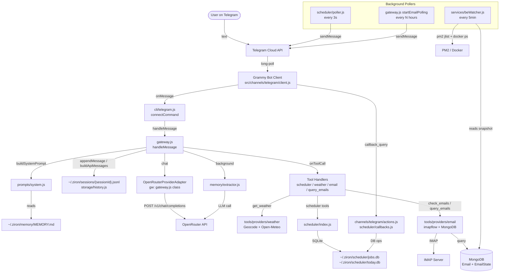
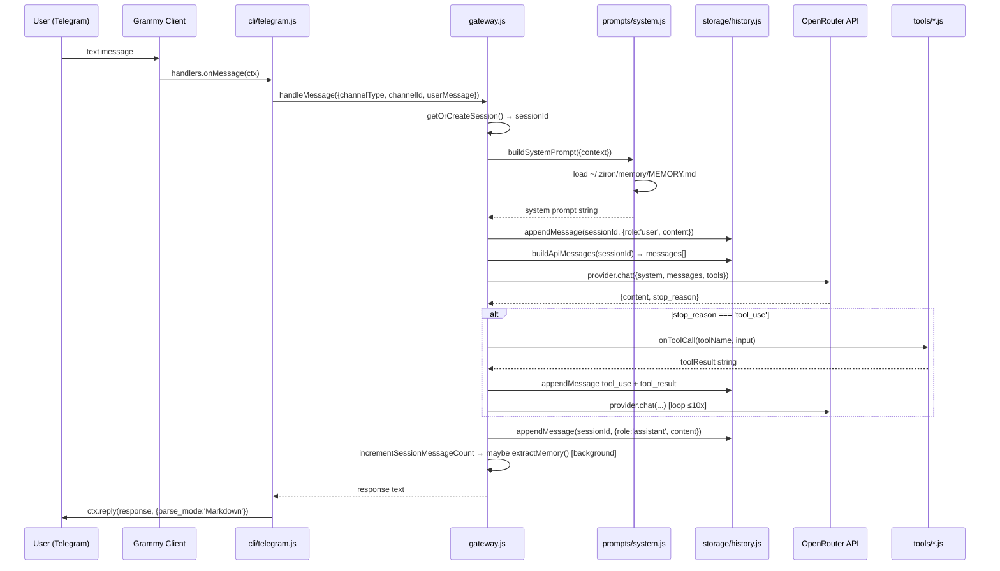
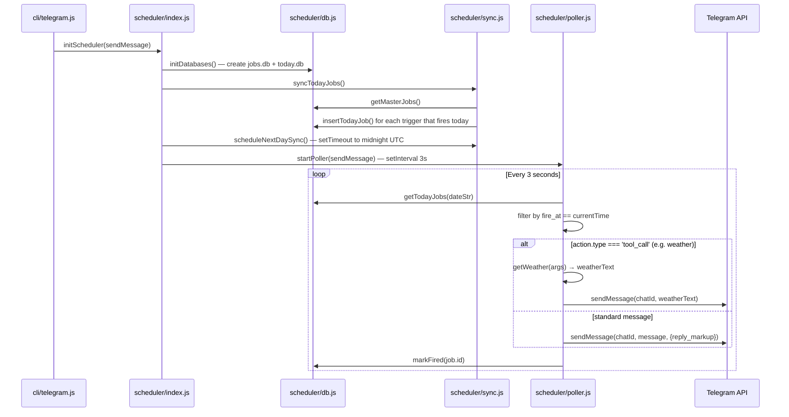

# System Overview — Ziron

> Updated: 2026-10-11 | Commit: `0b81d8e` + uncommitted working-tree changes (see §0)

---

## 0. Changes since the last audit (uncommitted, working tree only)

**Read this before trusting anything below that contradicts it.** Git HEAD is still `0b81d8e`
(the commit this doc and `docs/audit/RISKS.md` were originally written against), but the
working tree has uncommitted changes on top of it. Run `git status` / `git diff HEAD` to see
them verbatim; summary:

| Area | What changed | File(s) |
|------|--------------|---------|
| **Telegram inbound auth** | New `telegram.allowedUserIds: string[]` config + `createAuthMiddleware()` registered via `bot.use()` before any handler. Empty array = open to everyone (old behavior, with a startup warning). Non-empty = only those Telegram user IDs (`ctx.from.id`, never `ctx.chat.id`) get processed; everyone else is silently dropped (callback queries still get `answerCallbackQuery()` to clear the UI spinner). Every inbound update is logged once as `[Inbound] user=... decision=allowed\|rejected \| <payload>`. **This mitigates audit finding C1** (previously: no auth at all). | `src/channels/telegram/auth.js` (new), `src/cli/telegram.js` |
| **Forced outbound routing** | New `telegram.chatId` config (routing, *not* auth). When set, `replyTo()`/`typingTo()`/the scheduler/email/BeWatcher senders all redirect to this single chat instead of the chat that triggered them. Replaces the old dead `tools.email.notifyChatId` field (removed from `config.json.example`, resolving audit finding M6). Currently **unset** in `config.json` — outbound still goes to the originating chat. | `src/channels/telegram/reply.js` (new), `src/config/index.js:getForcedChatId`, `src/gateway.js`, `src/services/beWatcher.js` |
| **Self-hosted Telegram Bot API server support** | New `telegram.apiRoot` config. Empty (default) = official `api.telegram.org`. Non-empty = grammY talks to that URL instead — needed for a local `telegram-bot-api` server (file uploads >50MB, no official-API rate limits). **This machine has one running** — see §8/§10 "Local Telegram Bot API server". `config.json` currently sets `apiRoot: "http://localhost:8082"`, i.e. the bot is actively using the local server, not the official one. | `src/channels/telegram/client.js`, `src/config/schema.js`, `config.json.example` |
| **Chain-of-thought leak fix** | The configured model briefly leaked raw `<think>...reasoning...</think>` text into Telegram replies (reasoning model leaking into `message.content` instead of a separate `reasoning` field, sometimes with the opening `<think>` tag missing entirely). Fixed defensively in `OpenRouterProviderAdapter.chat()` by stripping both a full `<think>...</think>` pair and an orphaned leading `...</think>`. | `src/gateway.js` (`OpenRouterProviderAdapter.chat`, ~line 387) |
| **Model switched** | `providers.openrouter.model` changed from the schema default `anthropic/claude-3.5-sonnet` to `qwen/qwen3-235b-a22b-2507` — chosen specifically because OpenRouter documents it as **non-thinking** (no `<think>` blocks ever), on top of the regex fix above. Verified against OpenRouter's live model list; `qwen/qwen3-235b-a22b-instruct-2507` (with `-instruct`) is *not* a valid ID — don't reintroduce that typo. | `config.json` (gitignored, not shown here) |

**New known bug introduced by this work, not yet fixed**: `src/channels/telegram/reply.js` has two leftover debug statements — `console.log("dasd")` inside `replyTo()` and `console.log(ctx)` (dumps the full Grammy context object) inside `typingTo()`. Harmless but noisy/leaky on every single message; should be deleted.

**Operational note**: this bot runs under PM2 as process name `ziron` (not systemd). `config.json` is read once at process startup — editing it does **not** hot-reload; run `pm2 restart ziron` after any config change. The local Bot API server it now talks to runs as systemd unit `tg-bot-api.service` (binary `/usr/local/bin/telegram-bot-api --local --http-port=8082`), independent of the `ziron` PM2 process.

---

## 1. One-paragraph summary

Ziron is a personal AI assistant for "Hiro" delivered as a Telegram bot. It routes messages through a conversation-aware gateway to OpenRouter (or OpenAI) for LLM responses, tracks conversation history in local JSONL files, auto-extracts long-term memories from conversations, provides a built-in scheduler for recurring and one-shot reminders (stored in SQLite), monitors a university IMAP inbox for important emails (stored in MongoDB), fetches weather via the Google Geocoding + Open-Meteo APIs, and watches PM2 processes and Docker containers for service health. Everything is controlled through a `ziron` CLI and runs as a single long-lived Node.js process.

---

## 2. Tech stack

| Layer | Technology |
|-------|------------|
| Runtime | Node.js 20+ (ESM modules throughout) |
| CLI | Commander.js |
| Telegram bot | Grammy v1 |
| LLM (primary) | OpenRouter (OpenAI-compatible HTTP) |
| LLM (secondary) | OpenAI API / OpenAI OAuth (Codex) |
| Scheduler DB | better-sqlite3 (two local `.db` files) |
| Persistent data DB | Mongoose / MongoDB (email + BE snapshots) |
| Email | imapflow + mailparser |
| Config | dotenv + `yaml` npm package + JSON |
| Logging | Custom console logger (`src/utils/logger.js`) |
| No tests | `npm test` exits with error |
| No Docker / CI | ❓ unverified |

---

## 3. High-level architecture



---

## 4. Directory map

```
ziron-chat/
├── ziron.mjs              Entry point: Node version check, then loads src/index.js
├── config.json            Runtime config (gitignored); generated by onboarding
├── config.json.example    Template showing all config keys
├── .env.example           Env var template (OPENROUTER_API_KEY, OPENAI_API_KEY, TELEGRAM_BOT_TOKEN)
├── package.json           npm manifest; bin: ziron → ziron.mjs
└── src/
    ├── index.js           Main: calls initializeGateway() then runs Commander
    ├── gateway.js         Core: session management, LLM routing, tool dispatch, email polling init
    ├── api/
    │   └── client.js      ZironClient: tool-calling loop + history management
    ├── channels/
    │   └── telegram/
    │       ├── client.js  Grammy bot: registers commands, message/callback handlers; accepts apiRoot
    │       ├── auth.js    NEW — createAuthMiddleware(config): enforces telegram.allowedUserIds, logs all inbound traffic
    │       ├── reply.js   NEW — replyTo/typingTo: redirect output to telegram.chatId when set (has 2 leftover debug console.logs)
    │       ├── actions.js Inline button handler (newer "!act:" prefix pattern)
    │       └── index.js   Re-exports client.js
    ├── cli/
    │   ├── index.js       Commander program builder (registers all command groups)
    │   ├── telegram.js    "ziron telegram connect/status/test" — wires all services
    │   ├── config.js      "ziron config show/get/set" commands
    │   ├── auth.js        "ziron auth openai-oauth" OAuth flow
    │   ├── onboarding.js  "ziron onboarding" interactive setup
    │   └── test-openrouter.js  Standalone OpenRouter connection test
    ├── config/
    │   ├── index.js       loadConfig / saveConfig / updateConfig
    │   └── schema.js      DEFAULT_CONFIG + mergeWithDefaults
    ├── prompts/
    │   └── system.js      buildSystemPrompt: assembles 9 static+dynamic sections per message
    ├── storage/
    │   └── history.js     JSONL session store: createSession, appendMessage, buildApiMessages
    ├── memory/
    │   └── extractor.js   Background LLM call every 3 msgs to extract & persist memories
    ├── providers/
    │   ├── openrouter.js  Standalone chat() helper (used by CLI test commands only)
    │   ├── openai.js      Standalone OpenAI API chat helper
    │   ├── openai-codex.js  OAuth-based OpenAI helper
    │   └── openai-oauth.js  OAuth token acquisition flow
    ├── scheduler/
    │   ├── index.js       Public API: initScheduler, addRecurringJob, addOneshotJob, etc.
    │   ├── db.js          SQLite layer for jobs.db and today.db
    │   ├── sync.js        Daily midnight sync: master jobs → today_jobs
    │   ├── poller.js      3-second polling loop that fires due today_jobs
    │   ├── callbacks.js   Older inline button handler (done/snooze/skip/delete prefixes)
    │   └── parser.js      ❓ unverified (not imported by other modules in graph)
    ├── services/
    │   └── beWatcher.js   queryPm2 + queryDocker, takeSnapshot, checkStatus, initBeWatcher
    ├── db/
    │   ├── mongo.js       connectMongo / disconnectMongo singleton
    │   └── models/
    │       ├── Email.js   Mongoose schema for classified emails
    │       ├── EmailState.js  Mongoose schema for IMAP cursor (lastSeenUID)
    │       └── BeSnapshot.js  Mongoose schema for PM2+Docker baseline snapshot
    ├── tools/
    │   ├── index.js       getAllTools() — combines scheduler+weather only (email missing here)
    │   ├── scheduler.js   LLM tool schemas + pure calculation functions (calculateTime, etc.)
    │   ├── weather.js     LLM tool schema for get_weather
    │   ├── email.js       LLM tool schemas for check_emails + query_emails
    │   └── providers/
    │       ├── weather/
    │       │   ├── index.js    getWeather orchestrator (geocode → Open-Meteo)
    │       │   ├── geocode.js  Google Geocoding API call
    │       │   └── weather.js  Open-Meteo API call
    │       └── email/
    │           ├── index.js    checkNewEmails: IMAP fetch + LLM classifier + MongoDB persist
    │           ├── classifier.js  LLM-based email importance/category classifier
    │           ├── monitor.js  Email monitoring helpers
    │           ├── query.js    queryEmails + formatQueryResults (MongoDB query)
    │           └── README.md
    ├── scripts/
    │   ├── imap.js        One-off IMAP inspection script
    │   └── check-email-uid.js  Debug utility
    └── utils/
        ├── logger.js      Console logger with error/warn/info/debug/success levels
        └── time.js        Time utility helpers
```

---

## 5. Core flows

### Flow 1: User sends a Telegram message → bot replies



**Call order (file:function):**
1. `src/channels/telegram/client.js:createClient` → Grammy `bot.on('message:text')`
2. `src/cli/telegram.js:connectCommand` → `handlers.onMessage`
3. `src/gateway.js:handleMessage`
4. `src/gateway.js:getOrCreateSession`
5. `src/storage/history.js:createSession` (first time)
6. `src/prompts/system.js:buildSystemPrompt`
7. `src/prompts/system.js:getMemorySection` (reads `~/.ziron/memory/MEMORY.md`)
8. `src/storage/history.js:appendMessage` (user msg)
9. `src/storage/history.js:buildApiMessages`
10. `src/gateway.js:OpenRouterProviderAdapter.chat` → fetch to OpenRouter
11. `src/api/client.js:ZironClient.run` (tool loop)
12. `src/gateway.js:onToolCall` (when LLM calls a tool)
13. `src/storage/history.js:appendMessage` (assistant msg)
14. `src/memory/extractor.js:extractMemory` (background, every 3 msgs)

---

### Flow 2: Scheduler fires a reminder



**Call order (file:function):**
1. `src/cli/telegram.js:connectCommand` → `initScheduler(sendMessage)`
2. `src/scheduler/index.js:initScheduler`
3. `src/scheduler/db.js:initDatabases`
4. `src/scheduler/sync.js:syncTodayJobs`
5. `src/scheduler/db.js:getMasterJobs`
6. `src/scheduler/sync.js:shouldRunToday`
7. `src/scheduler/sync.js:createTodayJobsFromMaster` → `db.js:insertTodayJob`
8. `src/scheduler/sync.js:scheduleNextDaySync`
9. `src/scheduler/poller.js:startPoller` → `setInterval(checkAndFire, 3000)`
10. `src/scheduler/poller.js:checkAndFire`
11. `src/scheduler/db.js:markFired`

---

## 6. Data model

### SQLite — `~/.ziron/scheduler/`

**`jobs.db` → `jobs` table** (master recurring jobs)

| Column | Type | Notes |
|--------|------|-------|
| id | TEXT PK | UUID |
| name | TEXT | Human-readable job name |
| enabled | INTEGER | 1=active, 0=disabled |
| repeat_days | TEXT | JSON array of day numbers (0=Sun–6=Sat); `[]` = every day |
| specific_dates | TEXT | JSON array of `YYYY-MM-DD`; overrides repeat_days when set |
| time_triggers | TEXT | JSON array of `{time, message, buttons, action}` |
| chat_id | TEXT | Telegram chat ID |
| ref_id | TEXT | Groups related jobs for bulk-cancel via callback buttons |
| created_at / updated_at | TEXT | ISO timestamps |

**`today.db` → `today_jobs` table** (instantiated daily snapshot)

| Column | Type | Notes |
|--------|------|-------|
| id | TEXT PK | UUID |
| job_id | TEXT | FK → jobs.id (null for oneshot) |
| name | TEXT | Job name |
| chat_id | TEXT | Telegram chat ID |
| fire_at | TEXT | `HH:MM` or `HH:MM:SS` UTC |
| message | TEXT | Notification text |
| buttons | TEXT | JSON 2D array for inline keyboard |
| action | TEXT | JSON `{type, tool, args}` for tool-call jobs (e.g. weather) |
| enabled | INTEGER | 0 = cancelled |
| fired | INTEGER | 1 = already sent |
| source | TEXT | `'recurring'` or `'oneshot'` |
| date | TEXT | `YYYY-MM-DD` |
| ref_id | TEXT | Same as master job ref_id |

### MongoDB (optional — only when email or beWatcher enabled)

**`Email` collection** (`src/db/models/Email.js`)

| Field | Type | Notes |
|-------|------|-------|
| uid | Number | IMAP UID |
| mailbox | String | Default 'INBOX' |
| subject | String | |
| from | String | |
| date | Date | |
| snippet | String | Short body preview |
| important | Boolean | LLM-classified |
| category | String | deadline / exam / assignment / announcement / other |
| summary | String | LLM-generated summary |

Indexes: `{mailbox,uid}` unique, `{date}`, `{important,date}`, `{category,date}`

**`EmailState` collection** (`src/db/models/EmailState.js`)

Tracks the IMAP cursor: `mailbox` (unique), `lastSeenUID`, `lastCheckedAt`

**`BeSnapshot` collection** (`src/db/models/BeSnapshot.js`)

Singleton document (`_id: 'singleton'`): `createdAt`, `pm2[]` (name/pid/pm_id/status), `docker[]` (id/name/image/status/health)

### File-based stores

| Path | Format | Purpose |
|------|--------|---------|
| `~/.ziron/sessions/session-map.json` | JSON object | Maps `"channelType:channelId"` → sessionId UUID |
| `~/.ziron/sessions/{sessionId}.jsonl` | JSONL | Conversation history (one JSON object per line) |
| `~/.ziron/memory/MEMORY.md` | Markdown | Auto-generated index injected into system prompt |
| `~/.ziron/memory/user.md` | Markdown | User facts (role, timezone, preferences) |
| `~/.ziron/memory/feedback.md` | Markdown | Bot behavior feedback from conversation |
| `~/.ziron/memory/project.md` | Markdown | Ongoing tasks / goals |
| `~/.ziron/memory/reference.md` | Markdown | External links and resources |
| `~/.ziron/scheduler/sync-state.json` | JSON | `{lastSyncedDate}` — prevents duplicate daily syncs |
| `~/.ziron/prompts/prompt_{ts}.json` | JSON | **Debug dump of every LLM payload** (accumulates indefinitely!) |

---

## 7. Chatbot internals

### Prompt assembly (`src/prompts/system.js:buildSystemPrompt`)

Called fresh for every user message. Returns a single string of these sections joined by `\n\n`:

| Order | Function | Content |
|-------|----------|---------|
| 1 | `getIdentitySection` | Static: "You are ZIRON, a personal AI assistant created for Hiro." Role definition. |
| 2 | `getBehaviorSection` | Static: core principles, search vs knowledge guidance, error handling rules. |
| 3 | `getToneSection` | Static: language mirroring (Vietnamese/English), Telegram MarkdownV2 rules, no emojis by default. |
| 4 | `getToolsSection` | Static: when and how to use tools, parallel call instructions. |
| 5 | `getOutputSection` | Static: response format rules, templates for weather/reminders/news/crypto. |
| 6 | `getSchedulerSection` | Static: scheduler intent detection, CRITICAL timezone rules, all tool call patterns, button rules, refId usage. |
| 7 | `getWeatherSection` | Static: how to call get_weather, how to schedule a recurring weather job using coordinates. |
| 8 | `getEnvironmentSection` | **Dynamic**: current UTC time, user timezone, user location, available tools, `chatId`, `refId` (per-turn UUID). |
| 9 | `getMemorySection` | **Dynamic**: reads `~/.ziron/memory/MEMORY.md` if it exists. |

The `refId` injected in section 8 is a fresh `randomUUID()` generated per `handleMessage` call. It groups related scheduler jobs created in the same conversation turn.

### Conversation history management (`src/storage/history.js`)

- One JSONL file per session at `~/.ziron/sessions/{sessionId}.jsonl`
- `appendMessage` does a direct `fs.appendFile` (atomic with O_APPEND)
- `buildApiMessages` reads the full file, finds the last `isCompactBoundary=true` record, then converts storage records to OpenAI-compatible format:
  - `user` → `{role:'user', content: string|array}`
  - `assistant` → `{role:'assistant', content: string}`
  - `tool_use` → appended as `{type:'tool_use', id, name, input}` block inside preceding assistant message
  - `tool_result` → merged as `{type:'tool_result', tool_use_id, content}` block inside following user message
  - Consecutive `user` messages are merged
- `truncateAndSummarize` exists to add a compaction boundary but is **never called automatically** (history grows unboundedly)

### Memory extraction (`src/memory/extractor.js`)

- Triggered every `MEMORY_EXTRACTION_INTERVAL = 3` messages (counter tracked in-process per session)
- Runs **non-blocking** after the main response is returned to Telegram
- Makes a direct `provider.chat()` call (no conversation history) with a JSON extraction prompt
- Prompt asks the LLM to return `{user, feedback, project, reference}` JSON or `{nothing:true}`
- Parsed output is **appended** to `~/.ziron/memory/{type}.md` with a timestamp header
- `MEMORY.md` index is rebuilt with 500-char previews of each category file
- All writes use atomic temp-file + rename pattern

### Tool system

**Tool definitions** live in `src/tools/`:
- `scheduler.js` — 13 tools: 6 time calculators + 7 job management functions. The calculators (`calculateTime`, `calculateTimeRange`, etc.) are pure functions that also serve as LLM tools.
- `weather.js` — 1 tool: `get_weather`
- `email.js` — 2 tools: `check_emails`, `query_emails`

**Format bridge**: LLM tools are defined in Anthropic JSON schema format (`input_schema`), but OpenRouterProviderAdapter converts them to OpenAI format (`{type:'function', function:{name, description, parameters}}`). Response tool calls are converted back to Anthropic `tool_use` format.

**Tool-calling loop** in `src/api/client.js:ZironClient.run` — iterates up to `MAX_TOOL_LOOPS = 10`. All tool calls from a single response are processed sequentially.

**Tool dispatch** happens in `src/gateway.js:onToolCall` — a large `switch` statement on tool name that calls the appropriate provider function and returns a string result.

**No RAG pipeline** — memory is injected directly as text in the system prompt. There is no vector database or semantic search.

---

## 8. External integrations

| Integration | Purpose | Config key | Implementation |
|-------------|---------|------------|----------------|
| Telegram Bot API | User-facing interface (long-polling) | `telegram.botToken` | Grammy, `src/channels/telegram/client.js` |
| **Local Telegram Bot API server** (optional) | Self-hosted alternative to `api.telegram.org` (e.g. for >50MB file uploads) | `telegram.apiRoot` | Passed to grammY's `Bot({ client: { apiRoot } })`. On this machine: systemd unit `tg-bot-api.service`, binary `/usr/local/bin/telegram-bot-api --local --http-port=8082`, currently **active and in use** (`config.json.apiRoot = "http://localhost:8082"`) |
| OpenRouter | Primary LLM (200+ models via OpenAI-compat API) | `providers.openrouter.apiKey` / `model` | `gateway.js:OpenRouterProviderAdapter` |
| OpenAI API | Alternative LLM | `providers.openai.apiKey` | `src/providers/openai.js` (standalone only) |
| OpenAI OAuth | ChatGPT Plus models (no API key) | `providers.openai.oauth.*` | `src/providers/openai-oauth.js` |
| Google Geocoding API | Convert city name → lat/lon for weather | `tools.weather.googleApiKey` | `src/tools/providers/weather/geocode.js` |
| Open-Meteo | Free weather API | (no key required) | `src/tools/providers/weather/weather.js` |
| IMAP server | Fetch university emails | `tools.email.imap.*` | imapflow, `src/tools/providers/email/index.js` |
| MongoDB | Email storage + BE snapshots | `database.mongoUri` | Mongoose, `src/db/mongo.js` |
| PM2 CLI | BE process health | (system `pm2` binary) | `services/beWatcher.js:queryPm2` via `execFile` |
| Docker CLI | Container health | (system `docker` binary) | `services/beWatcher.js:queryDocker` via `execFile` |

---

## 9. Configuration & environment variables

**Loading priority**: `config.json` (file values) → overridden by `.env` → overridden by shell environment variables.

### Environment variables (`.env` / shell)

| Variable | Where used | Required |
|----------|-----------|----------|
| `OPENROUTER_API_KEY` | Primary LLM provider (`gateway.js`) | Yes (unless OpenAI configured) |
| `OPENAI_API_KEY` | Alternative LLM | No |
| `TELEGRAM_BOT_TOKEN` | Grammy bot client | Yes |
| `LOG_LEVEL` | `src/utils/logger.js` (error/warn/info/debug) | No (default: `info`) |

### `config.json` keys (generated by `ziron onboarding`)

| Key | Where used | Required |
|-----|-----------|----------|
| `providers.openrouter.apiKey` | Gateway LLM | Yes |
| `providers.openrouter.model` | LLM model name | No (default: `anthropic/claude-3.5-sonnet`) |
| `providers.openrouter.maxTokens` | LLM max output | No (default: 500) |
| `providers.openai.oauth.*` | OpenAI OAuth credentials | No |
| `telegram.botToken` | Grammy bot | Yes |
| `telegram.apiRoot` | NEW — grammY `client.apiRoot`; empty = official `api.telegram.org`, else a local Bot API server URL | No (default: empty) |
| `telegram.allowedUserIds` | NEW — inbound auth allowlist of Telegram user IDs (`src/channels/telegram/auth.js`); empty = open to all | No (default: empty — **insecure default**, see RISKS.md C1) |
| `telegram.chatId` | NEW — forces all outbound messages (replies, scheduler, email, BeWatcher) to this one chat regardless of origin; routing only, not auth | No (default: empty — replies go to originating chat) |
| `database.mongoUri` | MongoDB (email + BE watcher) | Only for email/beWatcher features |
| `user.timezone` | Injected into system prompt (scheduler) | Strongly recommended |
| `user.location` | Injected into system prompt | Optional |
| `user.name` | Config only (default: `'Hiro'`) | No |
| `tools.weather.googleApiKey` | Geocoding API | Required for weather tool |
| `tools.email.enabled` | Enable email monitoring | No (default: false) |
| `tools.email.pollIntervalHours` | Email poll frequency | No (default: 2) |
| `tools.email.startDate` | IMAP scan start date | No |
| `tools.email.imap.host` | IMAP server hostname | Required if email enabled |
| `tools.email.imap.port` | IMAP port | No (default: 993) |
| `tools.email.imap.user` | IMAP username | Required if email enabled |
| `tools.email.imap.pass` | IMAP password | Required if email enabled |
| `beWatcher.intervalMinutes` | BE health check interval | No (default: 5) |
| `settings.logLevel` | Logger level | No (default: `info`) |

---

## 10. Run & deploy

### Dev / run commands

```bash
npm install                          # Install dependencies

node ziron.mjs onboarding            # Interactive first-time setup → generates config.json

node ziron.mjs telegram connect      # Start the bot (long-running process)
npm start                            # Same as above

npm run dev telegram connect         # Start with --watch (auto-reload on file change)

node ziron.mjs telegram status       # Validate bot token
node ziron.mjs test-openrouter       # Test OpenRouter connection

node ziron.mjs config show           # Print current config (keys only, not secrets)
node ziron.mjs config set key value  # Update a config key (dot-notation)

node ziron.mjs auth openai-oauth     # Browser-based OpenAI login
```

### Telegram bot commands (user-facing)

| Command | Handler | Behaviour |
|---------|---------|-----------|
| `/start` | Grammar built-in | Welcome message |
| `/help` | Grammar built-in | Lists commands |
| `/ping` | Grammar built-in | Returns "Pong!" |
| `/newsession` | `handlers.onNewSession` | Resets conversation (new sessionId) |
| `/model` | `handlers.onModel` | Shows active model name |
| `/tasks` | `handlers.onTasks` | Lists all master scheduler jobs |
| `/task_today` | `handlers.onTaskToday` | Lists today's pending jobs |
| `/check_be` | `handlers.onCheckBe` | Compares PM2/Docker to baseline snapshot |
| `/be_snapshot` | `handlers.onBeSnapshot` | Saves current PM2/Docker state as new baseline |

### Ports / external access

No HTTP server. All communication is via Telegram long-polling. No ports to expose.

### Data directories (auto-created on first run)

```
~/.ziron/
├── sessions/          # JSONL conversation files + session-map.json
├── memory/            # MEMORY.md index + user/feedback/project/reference.md
├── scheduler/         # jobs.db, today.db, sync-state.json
└── prompts/           # Debug JSON dumps of every LLM payload (grows indefinitely!)
```

### No CI / no Docker Compose

❓ Unverified — no CI config or Dockerfile was found in the repository.

---

## 11. Code conventions

- **ESM modules** — all files use `import`/`export`, `package.json` has `"type": "module"`.
- **No TypeScript** — JSDoc type annotations (`@param`, `@returns`, `@typedef`) are the only type system.
- **No tests** — `package.json` test script exits with error.
- **Logging** — `src/utils/logger.js` provides `error/warn/info/debug/success`. Level controlled via `LOG_LEVEL` env var or `settings.logLevel` in config. `success()` maps to `console.log('✓', ...)`.
- **Atomic file writes** — memory and session files use `writeFile(tempPath) + rename(tempPath, finalPath)` to avoid partial writes.
- **Secure file permissions** — data directories are `0o700`, data files are `0o600` (owner-only).
- **Tool format bridge** — tools are defined in Anthropic schema format internally but converted to OpenAI format before every LLM call (`convertToolsToOpenAI`). Responses are converted back.
- **Language mix** — some log messages and comments are in Vietnamese (e.g. `"Gửi yêu cầu lên OpenRouter"`), reflecting the user's primary language.
- **camelCase for JS, snake_case for SQLite** — the SQLite schema uses `snake_case` column names; JavaScript callers use `camelCase` params with manual mapping.
- **All scheduler times are UTC** — the system prompt strongly warns the LLM about this and provides calculation tools.

---

## 12. Gotchas

1. **Debug prompt dumps never cleaned up** (`gateway.js:297–328`): Every single LLM call writes its full payload JSON to `~/.ziron/prompts/prompt_{timestamp}.json`. With no cleanup, this directory grows indefinitely and will eventually exhaust disk space on a long-running bot.

2. **Only OpenRouter works via the gateway** (`gateway.js:545`): Despite the config schema supporting OpenAI key and OAuth, the gateway's `initializeGateway` returns early with a warning if OpenRouter is not configured. OpenAI paths only work in standalone CLI test commands (`cli/telegram.js` provider selection is bypassed by the gateway).

3. **Session history grows unboundedly** (`storage/history.js`): `truncateAndSummarize` is implemented but never called automatically. JSONL session files grow forever with no compaction mechanism.

4. **Memory extraction every 3 messages is expensive** (`memory/extractor.js:17`): `MEMORY_EXTRACTION_INTERVAL = 3` means the bot makes an extra LLM call (billed against OpenRouter) for every 3 user messages. This runs in background but consumes API credits.

5. **Two overlapping inline button handlers** (`cli/telegram.js:231–243`): `handleInlineAction` (actions.js, `!act:` prefix) runs first; if it returns false, `handleCallback` (callbacks.js, `done:/snooze:/skip_today:/delete:` prefix) runs. The two systems use different callback_data formats and can conflict if not coordinated.

6. **`tools/index.js` is stale** (`src/tools/index.js:13`): `getAllTools()` only combines scheduler and weather tools. Email tools are added separately in `gateway.js:handleMessage` directly. Code that calls `getAllTools()` will miss email tools.

7. **`scheduler/parser.js` is unreferenced**: The file exists but no other file imports it. It may be dead code or an abandoned feature.

8. **`src/providers/*.js` files are partially dead**: The standalone `openrouter.js`, `openai.js`, `openai-codex.js` `chat()` functions are imported in `cli/telegram.js` for the provider-selection logic but the actual bot flow goes through the gateway's `OpenRouterProviderAdapter` class, not through these modules.

9. **Default `maxTokens: 500` is very low** (`config.json.example`): The `ZironClient.run` overrides this with `max_tokens: 8192` per LLM call (`api/client.js:74`), but the config default of 500 could mislead users thinking it controls output length.

10. **`src/channels/telegram/reply.js` has leftover debug statements** (uncommitted, new in this working tree): `console.log("dasd")` in `replyTo()` and `console.log(ctx)` (full Grammy context dump) in `typingTo()`. Fires on every single message/reply. Delete both — see §0.

11. **`telegram.allowedUserIds` defaults to empty = open to anyone** who has the bot token, same as the original C1 finding — the new allowlist mechanism (§0) only helps once you actually populate it in `config.json`. Check `config.json` directly; don't assume it's set just because the code supports it.

12. **Model/provider choice is not graph-visible** — `providers.openrouter.model` lives only in the gitignored `config.json`, currently `qwen/qwen3-235b-a22b-2507`. If reasoning-leak symptoms (`<think>` text in replies) reappear after a model change, re-check whether the new model is a "thinking" model and whether OpenRouter's `reasoning.exclude` applies to it — the regex strip in `gateway.js` is a safety net, not a guarantee for every model/provider combination.

---

## 13. Quick reference table

| Want to… | Open file |
|-----------|-----------|
| Change what the bot says about itself | `src/prompts/system.js:getIdentitySection` (line 18) |
| Change how the scheduler is explained to the LLM | `src/prompts/system.js:getSchedulerSection` (line 399) |
| Add a new LLM tool | 1. Define schema in `src/tools/*.js` 2. Add handler in `src/gateway.js:onToolCall` (line 654) |
| Change memory extraction frequency | `src/memory/extractor.js:MEMORY_EXTRACTION_INTERVAL` (line 17) |
| Add a new Telegram bot command | `src/channels/telegram/client.js:start()` + add handler in `src/cli/telegram.js:connectCommand:handlers` |
| Change the scheduler poll interval | `src/scheduler/poller.js:startPoller` — the `3000` ms constant (line 26) |
| Add a new config key with a default | `src/config/schema.js:DEFAULT_CONFIG` + `mergeWithDefaults` |
| Change which model is used by default | `config.json` key `providers.openrouter.model` (or `src/config/schema.js` default) |
| Fix the debug prompt dump accumulation | `src/gateway.js:315–329` — add cleanup or remove the write block |
| Change inline keyboard button behavior | `src/channels/telegram/actions.js:ACTION_REGISTRY` (done/delete/snooze) |
| Understand how emails are classified | `src/tools/providers/email/classifier.js` |
| Change BE health check interval | `config.json` key `beWatcher.intervalMinutes` (or `src/config/schema.js:DEFAULT_CONFIG.beWatcher`) |
| Add a new memory type | `src/memory/extractor.js:MEMORY_FILES` + update `buildExtractionPrompt` system prompt |
| Understand how history is sent to the LLM | `src/storage/history.js:buildApiMessages` (line 280) |

---

## How to update this doc

This document was written by reading every non-test, non-generated source file in the repo. To refresh it when the architecture changes:

1. Run `git log --oneline docs/SYSTEM_OVERVIEW.md` to see when it was last updated.
2. Run `git diff <last-update-commit>..HEAD --stat` to see which files changed.
3. For each changed file, re-read it and update the relevant section(s) — at minimum the **Directory map**, **Core flows**, **Data model**, **Chatbot internals**, and **Gotchas** sections.
4. Update the `> Updated:` date and `Commit:` hash at the top.
5. If new environment variables or config keys were added, update section 9.
6. If new external services were wired in, update section 8.
7. Re-run `git rev-parse --short HEAD` and paste the result into the header.

The code-review-graph MCP (`mcp__code-review-graph__detect_changes_tool`, `get_impact_radius_tool`) can help scope which sections need updating after a code change — run `detect_changes` on the diff to get a risk-scored list of affected modules.
